# Cooled Turbine Blade — Aerothermal CFD & Experimental Validation

**ANSYS Fluent | Conjugate heat transfer | Turbulence-model assessment | Mesh sensitivity | Experimental comparison**

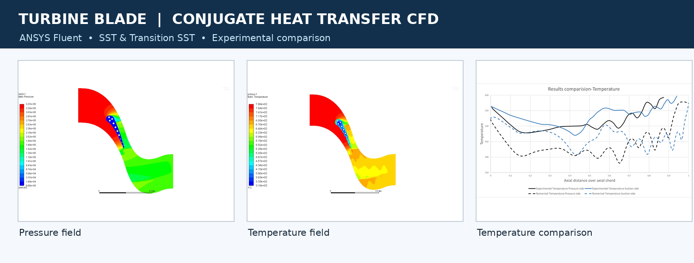

## Overview

A numerical investigation of **a cooled turbine blade**, coupling fluid-flow predictions with heat transfer through the blade. The study compares CFD results with reference experimental **pressure and temperature distributions** and examines how near-wall mesh resolution, turbulence modelling, and blade thermal conductivity influence the predictions.

The numerical study uses **ANSYS Fluent** and focuses on the supplied **5411 / Run 42** benchmark.

## Simulation setup

| Item | Description |
| --- | --- |
| Geometry | Cooled turbine blade with internal cooling passages |
| Physics | Turbulent flow and conjugate fluid–solid heat transfer |
| Solver | ANSYS Fluent |
| Turbulence models | **k–ω SST** and **Transition SST** |
| Inlet conditions (reported) | Total pressure **337,085 Pa**, temperature **788 K**, turbulence intensity **6.5%** |
| Outlet pressure (reported) | **169,853 Pa** |
| Boundaries | Periodic upper/lower boundaries, no-slip blade wall, prescribed cooling-hole temperatures |
| Mesh studies | Three meshes; nominal element counts **79,935**, **136,350**, and **388,312** |
| Thermal-property study | Constant versus piecewise-linear temperature-dependent conductivity |
| Reference data | Experimental blade-surface pressure and temperature distributions provided with the study |

These parameters are transcribed from the supplied project presentation. CFD case files and raw experimental datasets were not supplied with the archive.

## Geometry and computational mesh

| Blade and cooling-hole geometry | Near-wall mesh and passage refinement |
|:---:|:---:|
| 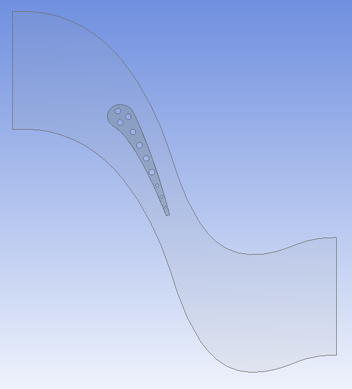 | 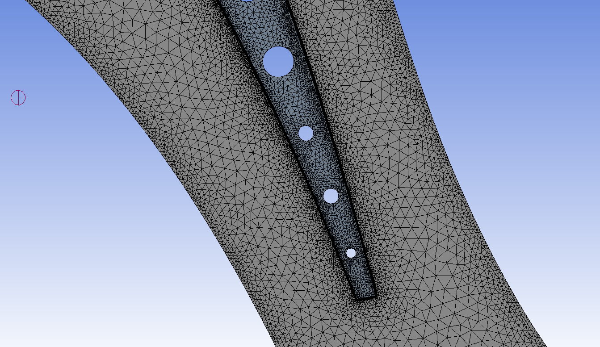 |

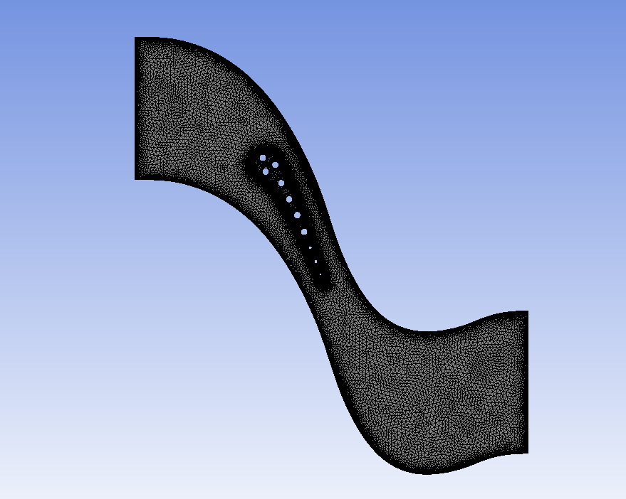

The mesh assessment focused on the blade boundary layer and refinement near the cooling passages, including a near-wall target of **y⁺ ≈ 1** for the refined study.

## CFD field visualizations

| Static-pressure contours | Temperature contours |
|:---:|:---:|
| 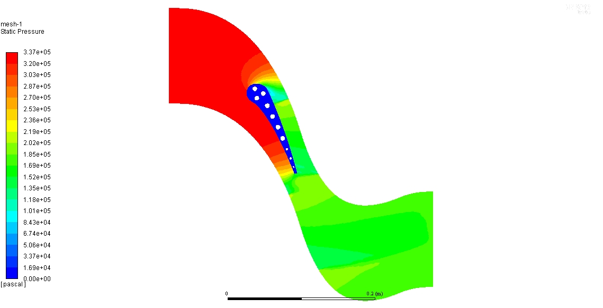 | 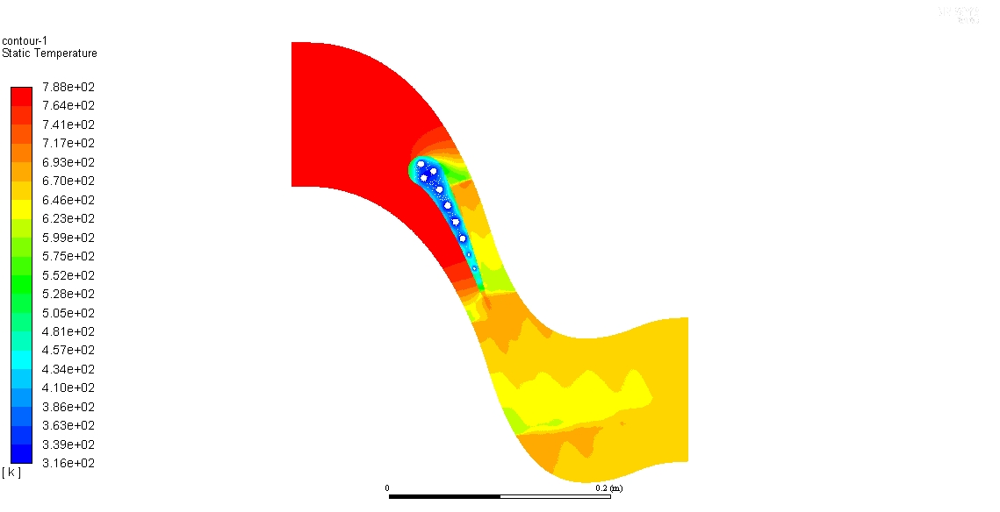 |

## Validation against experimental data

### Surface-pressure distribution

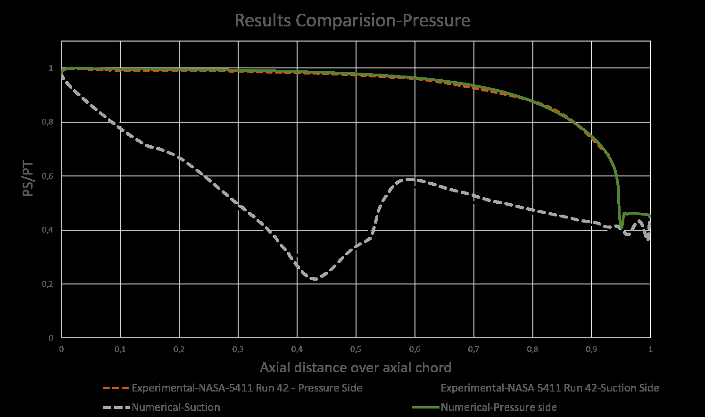

The original analysis reported broadly similar pressure trends between numerical and experimental distributions. The reference data are independent experimental measurements; they were **not generated by the CFD study**.

### Surface-temperature distribution

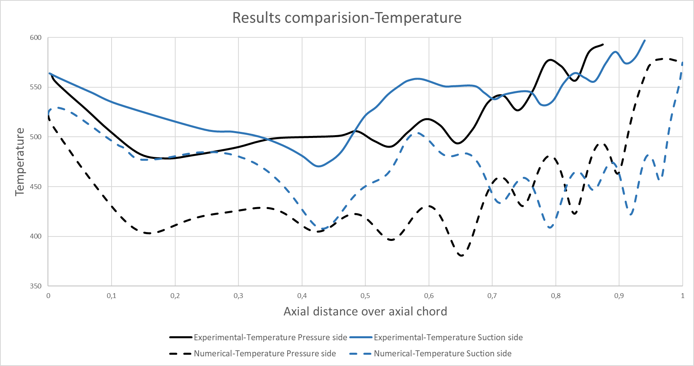

The baseline temperature predictions showed appreciable differences from the experimental measurements, even when the qualitative profile shape was captured. The investigation therefore examined several possible sources of thermal-prediction sensitivity.

## Sensitivity studies

### Near-wall and solid mesh refinement

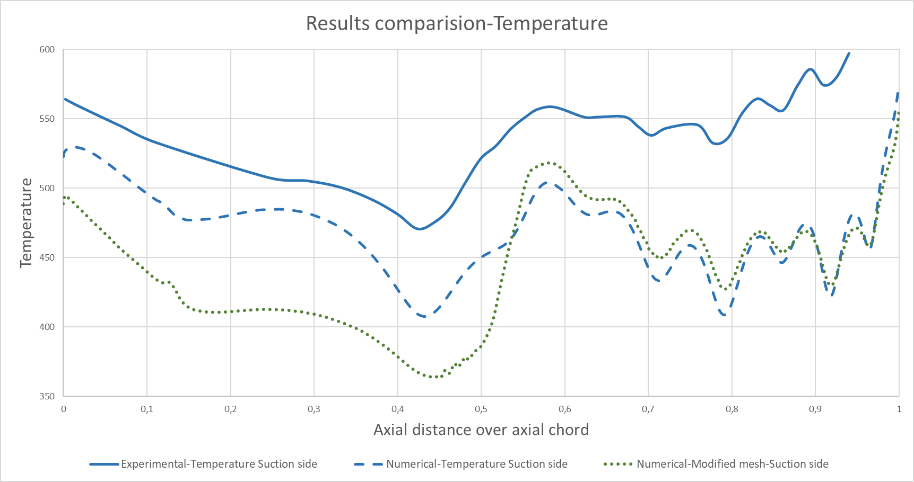

Refinement alone did **not** eliminate the temperature discrepancy in the reported study.

### Turbulence model: SST versus Transition SST

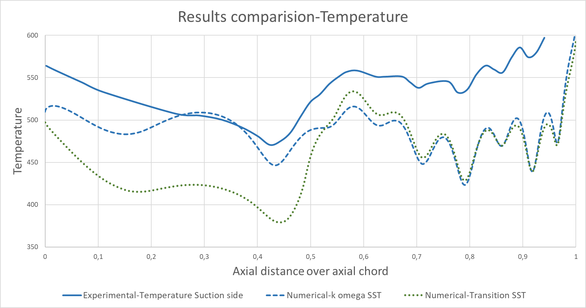

The turbulence-model comparison showed differences in wall-temperature predictions. The reported results favoured Transition SST for the temperature-profile shape, but switching models alone did not fully reconcile experiment and simulation.

### Blade thermal-conductivity model

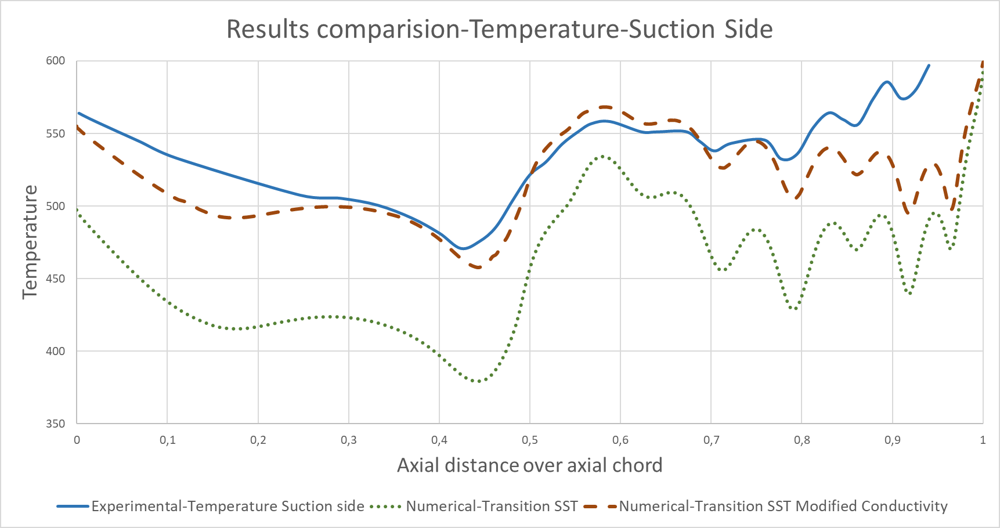

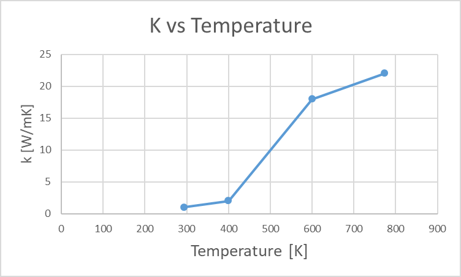

The blade-temperature predictions were strongly sensitive to thermal conductivity. Using a **piecewise-linear conductivity-versus-temperature model** improved agreement relative to the constant-property assumption in the reported comparison.

## Main takeaways

- CFD pressure trends were broadly consistent with the experimental benchmark, subject to the limitations of the plotted comparisons.
- **Thermal predictions were more sensitive** than the pressure field to modelling assumptions.
- Mesh refinement and turbulence-model changes did not independently resolve the reported temperature discrepancies.
- Temperature-dependent blade conductivity was an important factor in improving thermal agreement.

## Repository contents

The PNG figures are stored in the **repository root**, alongside `README.md`.

```text
.
├── README.md
├── project_overview.png
├── geometry.png
├── mesh_overview.png
├── mesh_cooling_passage.png
├── pressure_contour.png
├── temperature_contour.png
├── experimental_pressure_comparison.png
├── experimental_temperature_comparison.png
├── temperature_mesh_refinement.png
├── temperature_turbulence_models.png
├── temperature_conductivity_sensitivity.png
├── conductivity_vs_temperature.png
└── residual_history.png
```

**Data availability:** Figures are extracted from the original CFD study rather than regenerated from Fluent solver files. The repository does not include `.cas`, `.dat`, mesh files, or numerical data tables; therefore the plots cannot currently be reproduced quantitatively from these files alone. No experimental values, CFD predictions, or error metrics have been fabricated.
